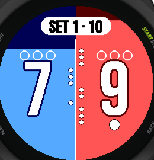
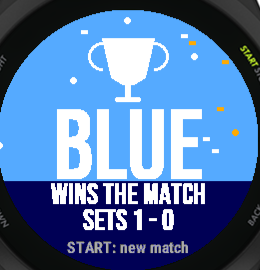
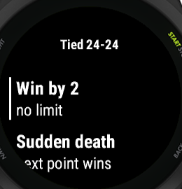
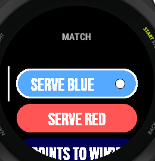
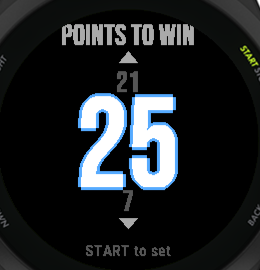
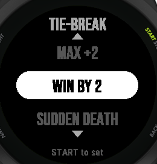

# Volleyball Score

A volleyball scoreboard for the Forerunner 255 (app name: Volleyball Score). Sideloaded only, not published to the Connect IQ Store.

  

  

- Split screen: each team's half fills with its colour (light blue left, red right) as it scores, in proportion to the points needed to win the set, with a thin strip showing who is who at 0-0. Down the divider a dot per point of the set, on the side of the team that scored it (the last 12), so a run of points shows as a stack on one side. Big white points with a dark outline for contrast, and three dots above each score are the sets won (filled = won). A white ribbon on top shows the set and the score that wins it.
- Sets go to 10 points by default (the fifth to 15 at most); first to 3 sets wins the match; **Sets to win** (1 to 5) is in the menu too. **Points to win** (hold UP menu, a roulette selector) changes the set goal to any value from 1 to 25 (10 by default; the deciding set is at most 15); the choice is logged, so DOWN undoes it, and a new match keeps it.
- **Tie ask**: when a set reaches one point short of its target all (24-24, or 14-14 in the fifth), a menu asks once per match how to play it out: Win by 2 (already highlighted, one press and carry on), Sudden death, Max +1, Max +2, or *Undo that point* if the tie was a slip. The choice is remembered, also for the next match, and can be changed in the hold-UP menu.
- **Winner screen**: when the match ends the whole screen turns the winner's colour with a trophy, confetti and the set score. START starts a new match (settings kept); DOWN takes the last point back; BACK returns to the finished scoreboard, where a point button asks "New match?".
- Tie-break rules: **Win by 2** (default), **Sudden death** (tied one point short of the target, the next point wins), **Max +1** (first to target + 1) or **Max +2** (first to target + 2). It applies from that point on and a new match keeps the choice.
- The serve marker (small white ball under the score) follows the team that scored the last point; change it from the menu.
- A short buzz per point, a double buzz when a set ends, a long double buzz when the match ends.
- The score is saved after every change, so leaving the app (or the watch sleeping) never loses the match.

## Buttons

Laid out like the screen: left buttons for the left team, right button for the right team.

| Button | Does |
|---|---|
| UP | point for the **left** (blue) team |
| START | point for the **right** (red) team |
| DOWN | undo the last action (as many times as you like, even back into a finished set); on the winner screen it takes the last point back |
| hold UP | menu with big rows: serve blue / serve red (in the team colours, ball on the one serving) / points to win / tie-break / new match. Points to win and tie-break open a roulette selector: UP / DOWN turn it, START sets it, BACK cancels |
| BACK | leave the app; reopen it and the score is still there |

## Build

Needs the [Connect IQ SDK](https://developer.garmin.com/connect-iq/sdk/) and your own developer key (`.der`).

```bash
monkeyc -d fr255 -f volleyscore/monkey.jungle -o volleyscore/bin/VolleyScore.prg -y <your developer_key.der>
```

## Tests

The match rules (set goal, win by 2, tie-break caps, fifth set to 15, undo across sets, serve, saving) have unit tests in `source/Tests.mc`. Open the simulator (`connectiq`), then:

```bash
monkeyc -d fr255 -f volleyscore/monkey.jungle -o volleyscore/bin/VolleyTest.prg -y <your developer_key.der> --unit-test
monkeydo volleyscore/bin/VolleyTest.prg fr255 /t
```

## Sideload

1. Connect the watch over USB.
2. Copy `volleyscore/bin/VolleyScore.prg` into the watch's `GARMIN/APPS` folder.
3. Unplug the watch. Volleyball Score shows up (with a pixel scoreboard icon) in the app list (START, then scroll to it).

## How it works

`Match.mc` keeps the match as a list of events (point left, point right, serve change, tie-break rule) and replays it to get the score, so undo is just dropping the last event and the saved state is that list. `VolleyView.mc` draws it (the Bebas Neue fonts are built by `python tools/gen_volleyscore.py` and committed in `resources/gen/`), `VolleyDelegate.mc` handles the buttons, menu and haptics.
